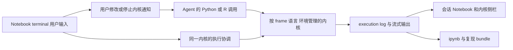
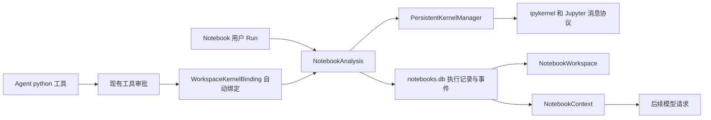
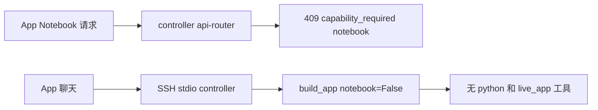
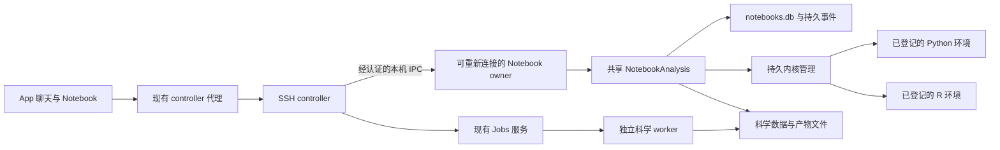

# Claude Science 与 OmicsClaw Notebook 对比及优化方案

日期：2026-10-15。适用场景：OmicsClaw-App 通过 SSH controller 连接远端分析环境。11 项产品决策已确认，实施规格见第 6–8 节，决策记录见第 12 节。第 1–5 节保留实施前固定基线的对比和诊断。

2026-10-16 范围调整：按用户“只打通最核心的步骤”的要求，本次交付收敛为 SSH 连接、已有分析环境登记、首次获准分析自动绑定 Notebook、Python/R 持久执行与结果展示、用户编辑后继续 Agent，以及已登记组学对象的保存和显式恢复。带对象环境维护、Job 回填、交互圈选扩展、完整复现包与 Replay、运行中 owner 升级和原生安装包发布延期；Q7 B 保留为后续维护的产品选择。这些延期项不再阻挡核心闭环验收。

实施进展：上述核心代码已合入两个项目的工作树，Python/R 正常保存与 Restore 已有实际 SSH 科学验证。App 的旧组件缓存、匹配组件分发及 Notebook 客户端依赖链已修复；已有控制依赖环境中的正常 SSH 分发、自动绑定、Agent/用户共享对象与重连也已实测通过。测试服务器首次联网安装依赖超时，成功检查采用离线准备的控制依赖，不计为联网安装通过。核心组件可在原有大小限额内打包，无需继续归档源码说明。具体结果及启动步骤见 [实施与验收记录](2026-10-15-notebook-implementation-and-acceptance.md)。以下 S0–S6 保留为原始完整路线图，交付范围以本段为准。

实施前的 SSH controller 路径明确关闭了 Notebook。后端装配使用 `DeploymentCapabilities(notebook=False)`，App 对 `/notebooks` 请求返回 HTTP 409 和 `capability_required: notebook`。这与用户确认的使用入口一致，解释了最初无法默认使用 Notebook 的现象。[后端关闭点][oc-controller]、[App 拒绝点][app-router]

普通 `oc desktop` 和 CLI 使用的共享装配已经默认提供持久 Python 内核，首次本地 `python` 调用会自动绑定 Notebook。已有能力包括执行记录、用户与 Agent 共享变量、取消、持久事件回放、代码单元导入导出，以及 Live App 状态进入后续模型请求。后续工作的起点是把这些能力接入 SSH controller，并修补现有 Notebook 的输出、恢复和导出缺口。

目标是在单台远端服务器上实现断线保活的 Python/R Notebook，优先登记已有环境，允许确认后原地升级。用户可接管执行；关键阶段自动 checkpoint，保存失败暂停后续数据修改；默认导出轻量复现包。实施先落实环境身份和可重新连接的内核管理，再接通 SSH 交互、组学状态与复现，不能以 Python 单链路或 Rscript 作业代替完整交付。

## 1. 对比基线与证据范围

| 对象 | 固定基线 | 本次证据 |
| --- | --- | --- |
| Claude Science | 本地 `Claude-Science-0.1.60.dmg` 的解包资料 | 恢复后的 JS、Python worker、前端构建产物；没有运行原产品 |
| OmicsClaw | `b04fd5099ecb1af732bd725235e5a9bdb9c7d6fe` | 该基线 Python 源码、测试、临时诊断探针 |
| OmicsClaw-App | `48a226f5303f270135a0afe40f06178a30ab7790` | 该基线 TS/TSX 源码、组件及代理测试 |
| 用户入口 | SSH controller | 用户在本次分析中确认 |

Claude Science 的结论限于该解包版本。其实现包含 Notebook 功能，不等于所有分支都已接受运行验证。对比阶段的 OmicsClaw 本地验证使用真实 Python 内核和脚本化 provider，没有调用商业模型，也没有连接用户正在使用的远端进程。后续实施阶段的真实 SSH、外部模型与浏览器证据另见验收记录。

逆向目录中的旧 Harness 对比报告仍把 OmicsClaw 描述为主要通过一次性 bash 脚本执行、持久内核尚在建设。这些判断已被当前代码和本次测试推翻。仓库的历史交付记录也只证明对应源码快照，不能证明当前 SSH controller 已继承 Notebook 能力。

对比与访谈阶段交付了本方案和独立审查，没有修改运行代码、连接配置或数据库。此后按用户确认进入 S0–S6 实施；已有未跟踪的演示文稿目录保持原状。

## 2. “默认开启”需要分别判断什么

| 层次 | 普通后端基线行为 | SSH controller 基线行为 | 推荐行为 |
| --- | --- | --- | --- |
| 能力是否装配 | 默认有 `python`、`live_app`、kernel manager | 三者均不装配 | 按已验证的科学解释器和传输能力声明可用性 |
| 是否立即启动内核 | 不启动，首次执行才创建 | 无 Notebook 内核 | 继续按需启动 |
| 是否自动建立 Notebook | 首次符合条件的本地 Python 调用时建立 | 无该链路 | 首次分析执行自动建立并绑定当前聊天 |
| 是否自动展示 | 有入口和侧栏，但主要靠点击和查询 | 路由拒绝；界面仍存在入口 | 首次执行显示状态和入口，按用户偏好展开侧栏 |
| 是否持续同步新执行 | 已知 execution 有 SSE，发现新 execution 的订阅不足 | 无 Notebook 订阅 | 会话事件发现新执行，再订阅具体执行输出 |
| 重连后是否仍有变量 | 同一内核存活时有；进程重启后没有 | controller EOF 生命周期尚未接入 Notebook | 区分连接恢复、历史恢复、内核仍存活和状态重建 |

这里的 `local` 是“相对于后端进程”。远端机器上的 `oc desktop` 使用自己的本地内核，仍可支持 App 远程访问。它与 `python(location="remote:<alias>")` 二次连接另一台计算主机，以及新的 SSH controller 传输，是三种不同路径。

当前不存在一个用户可设置的 Notebook 环境变量，就能解除 SSH controller 的两个关闭点。`--env-supply true` 只开启环境供给；`OMICSCLAW_DURABLE_TURN_EVENTS` 控制聊天事件持久化，都不能补齐 controller Notebook 接口。

## 3. 两者的 Notebook 如何工作

### 3.1 Claude Science



它以会话和执行日志组织 Notebook。前端按 Agent/frame、环境、语言以及内核实例展示执行；已结束内核的记录保留为只读历史。用户 terminal 附着到活着的 Python/R 内核，服务端要求 `noColdStart` 和预期内核身份，不能在用户输入时悄悄换成一个新命名空间。[内核列表与用户执行][cs-terminal]、[Notebook 前端][cs-pane]

Python 分析内核采用长驻 worker，主要通过 stdin/stdout JSON 行协议通信，不要求把 Notebook 设计建立在 Jupyter server 上。worker 捕获 stdout、错误、资源用量和图像；应用层负责权限、环境、执行日志及界面。[Python worker][cs-worker]

`skill` 加载 `kernel.py` 或 `kernel.R`，在现有内核中注入或登记到后续启动流程。插件源码有单独的来源记录，并进入复现导出。共享名称冲突时，它会报告已占用的名字和限定别名。[插件加载][cs-sidecar]、[冲突提示][cs-sidecar-collision]

Notebook terminal 是执行观察与交互入口，会话 bundle 是导出入口。可见实现不足以证明它具有完整 Jupyter 文档编辑器的增删、重排和无损导入能力；也不能由这些代码推断其侧栏一定默认展开。

### 3.2 OmicsClaw 普通后端



这是已经可运行的链路。Notebook 可以独立创建，也可以与聊天一对一绑定。默认装配开启自动绑定：首次本地 Python 调用把聊天绑定到 Notebook，再进入统一的 admission、执行记录和输出流程。内核仍按需启动。[默认装配][oc-build]、[自动绑定][oc-binding]

数据分为几个不同生命周期：聊天与长期记忆通常在 `memory.db`；交互 Notebook 在 `notebooks.db`；Python 对象在内核进程内。关闭聊天记忆不等于关闭 Notebook 持久化，因为后者有独立数据库。后续文档和设置应明确这一区别。

### 3.3 当前 SSH controller



已有 scientific job 通道面向有限作业。它不能直接替代需要共享变量、持续显示和精确取消的交互内核。SSH 设计记录也把完整 Notebook/kernel 恢复列在后续阶段。[SSH 设计记录][oc-ssh-doc]

## 4. 逐项比较

“已具备”均指当前源码中的对应路径，默认不包含 SSH controller。

| 维度 | Claude Science 0.1.60 解包实现 | OmicsClaw 当前实现 | 需要采取的动作 |
| --- | --- | --- | --- |
| Notebook 的组织中心 | frame 执行日志投影，按环境和内核实例分段 | 可编辑 cell 加 execution ledger，并维护聊天绑定 | 保留可编辑文档，增加清晰的会话执行视图 |
| 执行协议 | 自研长驻 Python worker；有 R 内核管理 | Jupyter client 驱动 ipykernel，底层支持 IRkernel | 保留现有内核协议，补足结果处理 |
| 科学计算默认入口 | Python/R 持久内核工具 | 普通装配默认有 Python；SSH 关闭 | 优先完成 SSH Python 闭环 |
| 内核启动 | 首次计算启动，用户 terminal 只附着活内核 | 首次 Agent 或用户执行可启动 | 明确“新建内核”与“附着现有内核” |
| 人与 Agent 共享变量 | 同 frame、语言、环境共享 | 绑定后的本地 Python 共享 | 扩展为显式执行上下文身份 |
| 并发协调 | 用户执行与 Agent bracket 按内核冲突键协调 | 单 Notebook active execution、事务与 manager lock | 保留现有互斥；把用户修改通知补全 |
| 多语言 | Notebook terminal 接受 Python/R | Notebook UI/API 为 Python；R 在底层和 code_run 路径 | R 是后续扩展，不要误报为完全没有 R |
| 多环境 | 环境是执行及内核选择的一部分 | manager 以 session、language、location 定位，解释器主要在装配时选定 | 引入环境身份及版本，避免中途替换解释器 |
| 技能 helper | Python/R 注入，延迟加载、冲突提示、来源日志 | Python AST gate、显式导出、延迟注入、失败可重试 | 持久化来源和加载状态，处理名称冲突 |
| 终端表达式 | 可见 terminal 面向表达式交互 | `1 + 1` 的结果当前丢失 | 保存并显示 `execute_result` 的 `text/plain` |
| 输出 | 日志、图像及工件体系分层 | stdout/stderr/error；当前本地捕获主要为 PNG | 建立受限 MIME 输出模型 |
| 执行审计 | execution log、环境和产物来源 | durable execution、CAS、command 去重、所有权租约 | 保留这些基础，补环境、helper 和代次 |
| 断线回放 | 执行流与执行日志共同支撑界面 | 单执行 durable SSE，回放不执行代码 | 迁移到 SSH 传输并增加会话级发现 |
| 内核停止 | interrupt/clear，用户停止原因进入 Agent 上下文 | cancel、回收和重启通知已有；Notebook 缺完整管理面 | 增加明确的 reset 语义和代次展示 |
| 进程重启 | 有 reattach/reap 分类与恢复提示；不能据此承诺内存永久保存 | 历史和绑定恢复，变量不恢复 | 在模型请求前明确告知命名空间已失效 |
| 用户修改的模型反馈 | 记录用户执行次数、内核和停止信息 | 最近 cell 与 live state 作为受限 user-role 数据 | 增加执行序号水位，避免仅靠最近八个 cell |
| 首轮自动绑定的上下文 | 会话执行管理与 runner 集成 | 同一次 exchange 中自动绑定后，context 要等下一轮才挂载 | 改为每次模型请求动态判断绑定 |
| Live App | MCP app 的实时状态、当前可见 tab、特定 handler | 单 Notebook 当前 HTML app、显式结构化状态、CAS | 先保留小接口，再按真实场景扩展 |
| `.ipynb` | 从日志分段导出；bundle 带环境和输入输出 | 代码单元交换，丢弃导入输出和 markdown/raw | 分清安全导入、文档保存和可复现导出 |
| 干净环境复跑 | bundle 实现收集 helper、环境、输入与 replay 数据 | helper 隐式注入未包含在导出中 | 补 bootstrap、哈希和依赖清单 |
| 子 Agent | 可按 frame 聚合主 Agent 与委派执行 | 子 Agent 没有主 Agent 的 NotebookContext 聚合 | 后续增加父子执行来源，不默认共享可变变量 |
| 大会话 | 前端显示上限、执行日志分页、导出数量上限 | snapshot 返回全部 cell/execution/feedback，前端全量渲染 | 增量分页、摘要索引、虚拟列表 |
| 部署 | 单产品内含 daemon、worker、前端等协作部件 | Python 后端、App 和不同运行模式独立演进 | 建立能力协商和同版本交付门槛 |

Claude Science 的分层值得借鉴，但不需要复制其 worker 协议或整个 `host.*` SDK。OmicsClaw 的 CAS、执行幂等、持久回放和导入不执行机制可以继续作为基础。

## 5. 当前不足及影响

### 5.1 SSH 能力被关闭且错误原因在界面丢失

后端明确关闭 Notebook，App 也明确拦截 Notebook 路由，属于未完成的接入工作。另一个可定位的问题在 `notebookRequest`：除了 `notebook_target_changed`，它主要读取响应中的 `detail`；controller 返回的 `error` 和 `capability` 没有完整保留，用户往往只看到 HTTP 409。[请求解析][app-client]

应先显示“当前 SSH controller 尚不支持 Notebook”，附带运行模式与版本信息。一般 CAS 冲突、环境缺失、能力关闭和内核已重启需要不同错误，不应统一显示成冲突或连接失败。

系统指导也需要随能力装配变化。当前 `TOOL_GUIDANCE` 和 `OMICSCLAW.md` 指导模型使用 `python` 与 `live_app`，controller 却不提供这些工具。应由同一份能力快照决定工具挂载、提示内容和 UI 状态。[工具指导][oc-guidance]

### 5.2 默认分析入口与界面同步没有完全衔接

`ChatNotebookLink` 在点击时查询绑定；侧栏拿到 `initialNotebookId`，但没有同时显式接收当前聊天和该次查询确认的 target。未指定 Notebook 的独立视图可选择列表第一项。已经有目标校验，不应把这个问题描述为没有防串线机制；欠缺的是把这些身份完整传过侧栏入口。[聊天入口][app-chat-link]、[侧栏挂载][app-panel]、[目标身份][app-target]

`NotebookWorkspace` 主要在挂载、选择、Reconnect 和已知 execution 的终态时刷新。它只给 snapshot 中已知的 active execution 建立 SSE。侧栏已经打开时，Agent 新建的 cell 或下一次执行没有统一的 Notebook 级发现事件。这是静态可见的接线缺口，本次没有用真实浏览器复现。[Notebook 组件][app-workspace]

改进应围绕 `{session_id, notebook_id, target}` 建立同一份上下文。第一次分析自动定位 Notebook；连续执行自动更新；用户切换聊天时按绑定切换，存在未保存草稿时给出明确选择。

### 5.3 表达式和富输出丢失

真实内核探针运行 `1 + 1` 后状态为 `completed`，但 stdout 为空，存储结果中没有值 `2`。`SessionKernel.execute` 收到 `display_data` 或 `execute_result` 后只提取 `image/png`，丢弃 `text/plain` 等其他表示。这也影响常见的 `adata`、`df.head()` 等交互检查。[输出处理][oc-output]

最小修复是保存 `execute_result.text/plain`，然后扩展表格和 JSON。HTML、SVG、widget 需要单独的呈现与信任策略。Jupyter 协议已经区分 stream、display_data、execute_result 和 error，可沿用这些类型，避免把所有结果挤进 stdout。[Jupyter 消息规范](https://jupyter-client.readthedocs.io/en/stable/messaging.html)

### 5.4 导出无法独立恢复技能 helper

本次探针先注册 `probe_double`，内核运行 `print(probe_double(21))` 成功；导出的 Notebook 只有这一行，干净命名空间执行立即得到 `NameError`。原因是 helper 通过 `store_history=False` 注入，而导出只读取 Notebook cell。[注入流程][oc-injection]、[导出实现][oc-ipynb]

隐藏初始化不占用户执行编号可以保留，但必须另存其源码、哈希和技能来源，并在复现导出中生成可见 bootstrap。Notebook 文件的语法有效与分析能复跑需要分别验收。

当前导出还不包含 PNG 图像内容，`execution_count` 固定为 `null`，也没有 kernelspec 或环境快照。导入跳过 markdown/raw 和已有输出是明确实现的限制；可以保持导入不执行，同时保存这些内容为惰性数据。[Notebook 格式规范](https://nbformat.readthedocs.io/en/latest/format_description.html)

### 5.5 技能加载身份与进程生命周期没有持久关联

`_session_sidecars` 和 `_injected_sidecars` 存在进程内。相同 binding 重建服务后，Notebook 历史仍在，helper 不会自动恢复。本次探针在重新创建 `WorkspaceKernelBinding` 后确认同一 helper 调用报 `NameError`。同一 manager 内的内核重建可以重新注入已登记 helper，两种恢复情况应分开说明。

注入器同时写裸名称和 `skill__function` 别名，但裸名称直接赋值，没有跨技能占用校验。两个技能导出同名函数时，后加载者可覆盖前者；当前提示也没有说明覆盖。Claude Science 的加载结果会区分 deferred、queued、失败及别名冲突，可以借鉴这些状态。[OmicsClaw 注入代码][oc-bootstrap]、[Claude Science 加载状态][cs-sidecar-collision]

### 5.6 内核代次与旧结果的关系不够明确

底层有重启、空闲回收、取消和 obituary 提示，不能把这些能力算作缺失。问题在于 Notebook 面：数据模型虽有 `session_epoch`，当前交互路径主要使用默认值 0，manager snapshot 也没有稳定的 kernel instance/generation 身份。进程重启后，旧 cell 的 completed 与新内核中对象是否存在之间缺少显式关联。[Notebook 数据模型][oc-store]、[内核 snapshot][oc-manager]

需要在新一代内核启动前标记旧结果对应的代次，并向 UI 与模型说明“历史结果保留，当前变量尚未恢复”。内核丢失不能以重新执行有副作用的 cell 来掩盖。

### 5.7 首次自动绑定后的上下文晚一轮生效

`build_augmentor` 在 exchange 开始时构造；当时尚未绑定便不挂 `NotebookContext`。同一 exchange 的 Python 调用完成自动绑定后，下一次模型调用仍没有该参考块。本次探针记录首个 exchange 两次请求的 block 数为 `[0, 0]`，第二个 exchange 为 `1`。[构造点][oc-augmentor]

工具返回值仍在历史中，所以不能说模型完全看不到刚执行的结果。欠缺的是“每次模型请求都刷新 Notebook 引用”的完整语义。可始终挂载一个轻量 augmentor，由其在每次请求时查询 binding。

目前最近八个 cell 的摘要有大小边界和信任标签，应保留。再增加 `last_seen_execution_seq`、用户修改水位、当前内核代次和恢复通知，避免仅依靠 cell 的更新时间解释命名空间变化。[上下文实现][oc-context]

### 5.8 Python 环境缺少贯通 Notebook 的选择与预检

完整 conda 环境含 `jupyter_client` 和 `ipykernel`；pip 核心安装不保证它们存在。当前 `env/doctor` 没有专门的 Notebook/kernel 检查，因此“后端能聊天”不等于“选定解释器能启动内核”。[依赖清单][oc-environment]、[Doctor][oc-doctor]

SSH controller 的科学环境与控制环境分离是现有设计。接入时要把已验证的 science interpreter 传给 `DeploymentCapabilities.science_python`，并检查该解释器内的 ipykernel 和所需科学库。不要用控制进程的 `sys.executable` 意外承载分析，也不要把重型科学依赖放进控制环境。

`manage_environments` 创建新环境后，不会切换已存在的 Notebook 内核。环境切换需要新内核身份、原状态保留说明和显式的恢复步骤。

### 5.9 长任务、R 与二级远程执行形成旁路

Agent 的 Python 工具把显式 `timeout_secs` 截到 45 秒；绑定后的默认 Agent 执行也是 45 秒。用户 Run 默认 1,800 秒，应用工具预算默认 600 秒。本次 runner 探针确认请求 600 秒实际收到 45 秒。[Python 工具][oc-python-tool]、[Notebook 执行][oc-notebook]

长任务被引导到 `code_run`，但该 runner 直接调用 kernel manager，没有经过 `NotebookAnalysis`。自动绑定后的内核 session 还可能是 `notebook:<id>`，而 code_run 使用聊天 session_id，不能假定两者一定共享变量。[code_run][oc-jobs]

`location="remote:<alias>"` 也不会进入本地自动绑定路径；默认记忆开启时，该回退路径可把执行写入 `memory.db` 中的 NotebookStore，而 Desktop 列表读取 `notebooks.db`。因此现有持久内核、Notebook 页面和 Jobs 的执行记录并未在所有模式下统一。

应让长任务返回的执行句柄也挂到同一 Notebook execution ledger，明确哪些任务共享内核，哪些任务隔离运行。R 和二级远程计算随后复用这套身份与记录；不要用“底层支持 R”替代 Notebook R 验收。

### 5.10 互操作、规模和维护边界

Notebook snapshot 当前加载全部 cell、execution 和 feedback；前端全量渲染。长会话会逐渐增加传输、解析和 DOM 成本。先加分页和序号增量，再考虑更复杂的缓存。模型上下文已经有独立的 24,000 字节上限，不需要把全量历史传给模型。

共享 `WorkspaceKernelBinding.notebooks` 直接导入 `entry/desktop/notebooks_manager.py`。CLI、Agent 和后续 SSH 已经依赖这项服务，目录名与实际职责不符。接入 controller 时可以将服务移到共享 entry 模块，Desktop 保留路由；迁移应保持既有事务与取消语义，不另写一套 Notebook 服务。

历史交付说明中的“必须显式绑定”“不支持 HTML app”与后来的自动绑定和托管 HTML 实现存在时间差。后续实施应更新当前功能文档，把历史验收记录保留为固定快照。

## 6. 已确认的目标设计

本节是待实现规格。第 1–5 节描述当前代码，第 9 节保留调查时的验证记录；两者不能作为本节能力已经交付的证据。11 项产品决策见第 12 节。

### 6.1 交付边界与默认行为

本次目标是在单台远端服务器上，经 OmicsClaw-App 的 SSH controller 提供完整的 Python/R Notebook：Agent 与用户共享各自语言的持久状态，用户可以接管，断线后内核和已接纳的计算保留，分析结果可以追踪和复现。Python 先接通可以作为中间里程碑，完整交付还必须通过 R 交互及组学验收。

| 行为 | 目标默认值 |
| --- | --- |
| Notebook 能力 | 环境、服务、权限与传输验证通过后自动提供；失败显示具体原因 |
| 建本与启动内核 | 首次获准的分析执行自动绑定当前聊天；按需启动对应语言内核 |
| 侧栏 | 首次分析显示入口并按保存偏好展开；用户关闭后不反复抢占界面 |
| 连续同步 | 自动发现当前 Notebook 的新执行，再增量订阅输出 |
| 断开 App 或 SSH | 保留内核和已获准、已持久接纳的执行；尚未接纳的新调用不因此获得执行权限 |
| 普通空闲 | 默认保留内核，由用户明确释放；自动回收是另行启用的配置 |
| 资源达到额度 | 限制新建内核，显示占用与可释放会话；不静默回收已有分析状态 |
| 环境来源 | 优先登记已有 conda/venv；R 显式登记解释器及库路径 |
| 安装或升级包 | 用户确认影响范围后允许原地修改；相关内核重启并记录新环境版本 |
| checkpoint | 配置的关键阶段成功后自动保存已登记对象，也提供手动保存 |
| 关键 checkpoint 失败 | 保留当前内核，暂停后续数据修改；可重试或由用户明确选择继续 |
| 恢复、重连和导入 | 不自动重跑历史；恢复对象由用户或获准的 Agent 发起 |
| 复现包 | 默认代码、来源、环境、参数、小型结果和大数据引用；完整打包可选 |

Slurm 等跨节点调度、任意环境热切换、通用进程序列化和完整 Jupyter 编辑器后置。保留现有 Jupyter client、NotebookAnalysis、Jobs 和权限服务；无需复制 Claude Science 的 worker 协议或另建调度系统。

### 6.2 执行身份与数据记录

以下字段表达需要落地的含义，最终名称在协议实现时固定。沿用现有 binding、revision、execution_id 和 command 去重，扩展已有存储，避免创建相互竞争的执行记录。

| 身份或记录 | 作用 |
| --- | --- |
| workspace / authority / target | 确定工作区、操作主体和执行位置 |
| session_id / notebook_id | 关联聊天与 Notebook；不同聊天默认不共享可变命名空间 |
| language / environment_id / environment_revision | 定位 Python 或 R 环境；原地更新保持逻辑环境身份，产生新版本 |
| kernel_instance_id / generation | 区分具体内核进程和每次重启；controller 重连不增加仍存活内核的代次 |
| cell_id / source_revision | 定位可编辑文档中的代码版本 |
| execution_id / client_command_id / command_digest | 记录实际提交并检测同一命令携带不同语义的重试 |
| notebook_seq / execution_event_seq | 分别用于发现新执行、恢复单次执行输出；明确事件命名空间 |
| user_state_watermark / state_seq | 标识模型依据的用户操作与计算状态，作为继续执行的前置条件 |
| dataset_id / object_revision / selection_id | 关联数据版本、当前对象和细胞或样本选择 |
| checkpoint_id / artifact_id / job_id | 关联恢复点、产物和隔离作业 |

controller epoch、Notebook owner 的租约、事件流 owner epoch、kernel generation 各自代表不同生命周期。旧 controller 的写请求应被拒绝；同一内核的新观察连接仍能读取旧 execution 和历史事件。

Notebook 文档允许编辑，实际执行记录按执行时的代码、环境、输入、来源和结果追加。修改 cell 不覆盖旧 execution；当前输出与源码不再匹配时明确标记或移除当前展示。技能加载另存源码、哈希、导出名称和注入状态；隐藏初始化不占用户执行编号，但必须能在导出中还原。

### 6.3 SSH 接入与内核所有权

采用可重新连接的 Notebook owner 管理执行和内核，生命周期独立于 SSH controller 的 stdio 连接。owner 在远端按需启动；同一 workspace 的 Notebook 写入仍由同一套业务状态机负责。优先使用当前用户的私有本机 IPC，不增加产品 HTTP 服务。



controller 保留模型调用、用户身份、审批和观察连接。Notebook owner 持有 Notebook 执行 admission、输出落盘、内核连接及取消能力。复用 NotebookAnalysis 的事务、幂等和取消逻辑，提取共享服务时保留 Desktop 作为路由适配器；CLI 和普通 Desktop 不必因此改成强制常驻服务。

Agent 调用仍先经过现有权限 gate。controller 将批准范围和代码、环境、预算、generation 等命令语义绑定后交给 owner，owner 验证有效主体和命令身份再持久接纳。用户 Run 依据经认证的显式操作；Live App 发布 state 不具备执行代码的权限。科学内核及 owner 不需要模型凭据，进程启动沿用现有凭据清理与原生 sandbox 边界。

owner 的单实例控制应与现有 controller workspace 锁分开。连接租约失效只使旧写者失效，不能直接等同于销毁内核。进程出生信息、当前用户、workspace、启动 nonce 等证据用于核对归属；不能仅凭 PID 连接或终止进程。

| 操作 | 复用点 | SSH 规格 |
| --- | --- | --- |
| 能力、列表、snapshot、binding | 共享 Notebook 服务 | 返回语言、环境、状态和失败原因；列表及 snapshot 按字节有界 |
| 自动绑定 | WorkspaceKernelBinding 与 NotebookAnalysis | 首次 Python/R 分析进入同一绑定服务；无需向同机建立第二层 SSH |
| 编辑与导入 | save / import_document | 保留 CAS、类型及大小检查；导入不执行 |
| Run | execute / admission | 持久接纳后返回原 execution；command digest 冲突拒绝 |
| Cancel | cancel | 校验 execution、generation 和当前进程归属；区分请求已接收与中断已确认 |
| 新执行发现 | Notebook 序号事件 | 会话级订阅发现 execution，不与单次输出 cursor 混用 |
| 单次输出回放 | DurableTurnEventLog | owner 落盘，controller 代理读取；支持 cursor、gap 和写入失败状态 |
| 图像、checkpoint、导出 | 文件与 artifact 边界 | 元数据走 RPC，大内容走受限分块读取；路径、大小和校验和可核对 |
| Live App 与 state | NotebookApps / NotebookLiveState | 保留 app revision 和执行来源校验，加入数据版本及选择引用 |

同一命令重试不得再次启动代码。进程在产生外部副作用后、写终态前死亡时，结果可能待核对；不得对任意 Python/R 代码承诺端到端 exactly-once，也不得通过自动重跑来恢复显示。

### 6.4 生命周期、断线与资源回收

UI 和模型分别显示连接状态、内核状态、执行状态及持久化状态。`disconnected` 不等于计算中断；历史 `completed` 不等于当前内存仍有对应对象。内核状态至少区分未启动、就绪、忙碌、中断中、丢失和已关闭。

| 事件 | 必须发生的行为 |
| --- | --- |
| App 关闭、SSH EOF、controller 退出或被杀死 | 停止新的 controller admission；owner 与已持久接纳的执行继续，结果独立落盘 |
| controller 重连 | 验证 owner 与内核身份，恢复订阅及状态；内核仍活着则继续原 generation，不重建或重跑 |
| owner 异常退出 | 先核对进程和执行证据；能证明归属才重新接管，证据不足标记结果待核对并阻止重复执行 |
| 内核或服务器实际故障 | 保留历史，标明变量丢失；新 generation 通过显式 checkpoint 恢复 |
| 用户 reset、释放或原地环境更新 | 展示受影响对象及恢复点；按明确操作终止旧内核，新启动使用新 generation |
| 空闲或资源达到额度 | 默认不回收既有内核；展示占用并限制新建，配置了自动回收才按该策略执行 |
| 输出持久化失败 | 计算状态与记录状态分开；停止未确认的后续 admission，不能展示伪成功 |

现有 30 分钟空闲和 6 小时存活相关回收规则不能直接成为本目标的默认值。内核年龄回收、科学执行限时、资源硬限制和网络观察超时是不同政策。执行限时必须在运行前展示实际有效值；断线和观察超时不取消已接纳的计算。

内核数量、科学内存、控制进程 RSS、磁盘和输出各有可配置额度。首版按目标机器设置并测量，不在没有基准的情况下宣称支持固定规模。主动增长的对象仍可能遇到真实内存故障，需记录实际原因；“限制新建内核”不能被描述成对所有内存增长的保证。

### 6.5 环境登记与原地更新

App 提供现有环境登记入口。Python 记录真实解释器路径、版本、前缀、必要包及 ipykernel；R 记录真实 R 路径、版本、库路径、IRkernel 和方法所需包。控制环境单独检查 jupyter_client 等轻量依赖。科学包探测在所选科学进程内执行，不能用控制环境的可导入性代替。

现有受管 science publication 的 manifest/lock 验证继续保留。新增登记环境类型，定义其路径、权限、探测和版本证据，不能把任意 conda 路径伪装成已通过旧协议的 publication。指纹是观测到的环境快照；可变目录发生外部修改时，重新验证并使受影响状态失效，不假定有完整文件系统不可变性。

用户已选择允许原地安装或升级。更新过程按以下顺序实现：

1. 解析目标解释器及 R 库目录，列出包变更、受影响的受管内核和作业、checkpoint 与重启影响。用户确认针对本次范围，不自动授予后续安装权限。
2. 按真实环境范围协调维护和加锁，包含引用同一环境的受管会话；暂停新的相关执行，等待正在运行的计算完成，或由用户明确中断。
3. 核对已登记对象的 checkpoint。关键保存失败则保留旧内核，暂停更新；只有用户明确接受本次状态损失后，才能继续相应操作。
4. 停止受影响的旧内核，执行已确认的安装或升级，避免活进程混用更新前后的包。
5. 验证解释器、库路径和必要依赖，保存新环境版本，再建立新内核代次。对象恢复仍是显式操作；旧执行和待审批代码不能自动重放。

安装失败或验证不通过时，环境标记为需要修复，不恢复普通执行。保留更新前后清单与安装结果；包清单不保证可以完整回滚。此流程只协调 OmicsClaw 管理的内核和作业，不假定能控制其他应用。

### 6.6 用户接管与模型状态校验

用户点击 Run 后，服务端先记录接管请求并暂停 Agent 后续执行。当前计算继续到完成，或由用户明确中断；随后执行用户代码。不得为了让用户代码尽快运行而自动取消昂贵计算，也不得锁住整轮聊天要求用户无限等待。

每次模型请求读取当前 binding、kernel generation、用户变更水位、最新执行及数据摘要。Agent admission 在执行前再次比较它所依据的状态；用户在推理或审批等待期间改变了对象，旧状态代码应被拒绝，模型刷新后重新生成调用。锁与水位检查必须覆盖比较到接纳之间的竞争。

中断或异常也可能已经改变变量。完成用户操作、reset、环境更新或异常处理后，Agent 重新检查关键字段再继续。这里的“继续”不等于自动重试旧命令或免除工具审批。

Live App state 保留 user-role、untrusted、大小限制与服务端来源。发布选择或参数本身不触发推理和代码执行；准备进入模型请求的回执不代表模型已经理解。

### 6.7 组学数据与选择状态

为首批 AnnData、counts/metadata 表格以及 RDS 对象登记轻量数据引用。数据保留在科学环境或文件中，controller 和模型只接收有界摘要。

| 内容 | 至少记录 |
| --- | --- |
| 数据来源 | dataset_id、文件或生成 execution、版本和必要校验和 |
| 对象状态 | object_revision、kernel generation、shape、格式和是否仍可访问 |
| 生物学身份 | 样本、条件、donor、物种或参考版本等实际已知字段；未知项明确保留为未知 |
| 矩阵语义 | counts、归一化矩阵、assay/layer 的选择及其处理来源 |
| 行列映射 | 稳定的细胞/样本与基因身份；跨样本重复 barcode 需要组合身份 |
| 派生视图 | embedding、聚类、图形与其依赖的数据及对象版本 |

不能从任意 Python/R 代码可靠推断全部副作用。通过显式登记、受支持的检查函数和已观测执行推进版本；无法判断变更范围时，先使旧摘要与选择失效再核对。不按每个 cell 全量哈希大矩阵、densify、全量 repr 或写回 h5ad。

圈选使用服务端 selection_id，绑定 dataset/object/视图版本、稳定行身份及数量。数千或数万 ID 保存为服务端集合或受限文件，模型读取摘要和有界样本；现有 100 项 JSON 数组不通过简单放大承担大集合。过滤、重排或替换对象后，旧选择必须验证或显式映射，不能仅凭 app revision 或 shape 相同继续分析。

用户可以明确清除当前选择，包括已经失效的选择。清除操作核对原选择引用与当前分析版本，仅清除当前指针并保留历史；另一个窗口已经建立新选择时，旧清除请求不得影响它。清除不执行代码，也不绕过对象有效性检查。

样本对齐、counts 与 log layer、统计单位属于科学验收。系统记录证据并执行明确检查，不把 Notebook 的技术成功当成方法选择正确。

### 6.8 checkpoint 与保存失败

关键阶段由分析代码或已配置策略明确标记，例如 QC、归一化或整合成功完成。只保存已登记且支持序列化的对象；不根据聊天文字猜测阶段结束，也不承诺冻结整个 Python/R 进程。

checkpoint 在一致的对象状态下写入，记录数据、环境、内核代次、生成 execution、格式、大小和校验和。先完成临时文件写入及校验，再发布可恢复记录；部分文件不得展示为有效恢复点。大对象序列化在科学进程中完成，并协调写入期间的对象修改。

阶段执行成功时，在同一 Notebook 事务中保存唯一的阶段标记、checkpoint 意图、对象版本和修改屏障，再派发下一次修改。已提前排队的 cell 也须等待；owner 退出后恢复原保存意图，不重跑已完成分析。多对象保存整组发布，Notebook 与 artifact 存储之间的中断通过固定文件与摘要补齐，不能暴露半组恢复点。

保存采用服务端固定的非破坏性停止策略。超时不自动终止或重建内核；无法确认序列化已停时，继续保留屏障，禁止并发重试和修改。序列化参数不得隐式改变原对象；AnnData 首批固定禁止字符串类别转换，并对未验证的 backed/view 对象明确拒绝。保存与校验的临时文件、验证内存和在途操作都计入有效预算。

保存频率、磁盘额度与保留数量可配置。仍被 Job、复现 recipe 或用户保留标记引用的 checkpoint 不能被普通自动清理删除。释放内核不自动删除历史或 checkpoint。

关键保存失败后，保留当前内核和已完成计算，暂停后续数据修改。允许受支持的状态读取、保存重试及用户明确选择继续；不能把任意代码仅凭文字描述视为只读。明确继续关联本次失败、对象版本及代次，记录恢复点缺口，不豁免未来保存失败，也不把失败改写为成功。

环境更新前保存失败时，暂停安装和旧内核关闭。保存证明只覆盖登记对象；其余内存仍属未知。若用户接受本次未保存状态损失，确认须绑定维护计划、影响摘要、每个内核代次、修改水位和实际保存失败，并进入原维护审批。普通“继续分析”只解除对应失败的修改屏障，不能授权关闭内核或安装；范围或水位改变后重新确认。

恢复动作始终显式发起，首批整组加载到未执行分析的新 reserved generation。manifest 固定对象到变量的映射、序列化版本、文件身份与兼容摘要；加载成功后发布新对象引用及精确来源。加载期间及失败后保留持久屏障，防止普通 ready 状态或重连暴露半成品；失败目标需明确释放后另建代次。旧视图和选择保持失效，只有显式核对映射后才能使用。

### 6.9 长任务、R 与执行预算

支持共享内核的长 cell 和独立进程的有限 Job。长 cell 使用当前 Python/R 状态，由 owner 管理；Job 使用固定输入 checkpoint、环境版本与代码或技能来源，在现有 Jobs 服务中执行，Notebook 只引用它的身份、状态和产物。

Agent、用户 Run 和作业界面展示同一个实际有效的执行预算。请求预算与部署上限在接纳前确定，不能暗中截为 45 秒。网络观察超时不等于执行超时；取消要等待真实停止证据，未确认时保留取消中或结果待核对状态。

Job 产出 manifest 通过校验后，显式加载回同一 Notebook，并记录新的对象版本；独立进程不宣称与交互内核共享变量。沿用现有作业接纳、去重和恢复能力。当前 SSH 没有默认 code_run runner，因此实施时必须接通经过验证的科学 runner 输入，不能只在提示词中引导到 code_run。

R 通过显式环境启动 IRkernel，禁止悄悄使用无关的默认 kernelspec/library。Python 与 R 命名空间分离，通过有版本的文件交换结果；不承诺把 AnnData 和 R 对象自动互转。R 的核心验收在真实交互内核里运行上游统计代码，不以 Rscript 或 Python helper 代替。

### 6.10 输出、导入与复现导出

保存并呈现 stream、text/plain、表格或结构化结果、PNG 与异常；输出持久化与界面使用同一来源。大输出有摘要、截断标记和 artifact 引用。HTML/SVG 等需要既有隔离呈现策略，任意 HTML 不获得内核权限。导入保存声明支持的 code/markdown/raw 和惰性输出，不执行代码。

导出区分当前可编辑文档、实际执行审计和可执行复现 recipe。审计按 language、environment_revision 与 kernel generation 分段，保留执行时源码；失败、取消、结果待核对和有副作用的记录不自动组成可重放步骤。recipe 明确初始化、固定 helper、输入、checkpoint 和所选执行之间的依赖。

默认轻量包包含 Notebook、固定 helper/bootstrap、环境清单、参数和种子、必要小型结果，以及大型输入和 checkpoint 的路径映射、大小、版本、校验和。缺少数据时说明需要补充的文件；轻量包不宣称脱离数据即可运行。完整打包由用户选择，打包前估算体积并检查空间，保持科学数据与控制进程安装体积分别统计。

相同环境下先核对数据、样本和产物身份，再按方法规定容差或不变量验证结果。多环境清单和 helper 哈希本身不能证明科学复现；导出包不自动运行。

### 6.11 有界传输与部署能力

现有 SSH frame 上限为 1 MiB，分页和大对象分块必须随首条 Notebook 路径交付。snapshot 只返回有界元数据及分页引用，不能先加载全部历史再截断。图像、文件和复现包不进入模型桥；按身份受限读取并验证长度、范围和校验和。慢观察者不能阻塞持久记录、取消或其他会话。

能力信息分别反映服务、传输、已登记环境及 Python/R 可用性，显示缺少的依赖或配置。App 安装的 control profile、controller 方法白名单、远端来源校验和打包版本一并更新；现有 base profile 通过不代表 Notebook client 已安装。新增 owner 的代码、依赖与 RSS 计入控制预算，和 controller 合计核算，不能通过拆分进程规避已有 SSH 部署限额。

模型指导由实际能力生成。重连和目标切换保留现有 fencing：草稿、待提交命令、cursor 和写权限都不能串到另一 authority/workspace。数据迁移使用现有数据库的可检查升级；旧记录缺少 generation 或环境证据时标记未知，不能补造已经存在的内核状态。

## 7. 按依赖重排的实施清单

以下 S0–S6 替代原 M0–M7 排序，定义每阶段的交付范围与门槛；当前进度见[实施与验收记录](2026-10-15-notebook-implementation-and-acceptance.md)。每阶段产生可评审的后端、App 和验证改动；完整目标到 S6 才完成。

| 阶段 | 后端范围 | App 范围 | 完成门槛 |
| --- | --- | --- | --- |
| S0 契约与环境登记 | 明确身份、环境版本、owner 生命周期、消息预算、迁移；登记已有 Python/R 环境并预检 | 环境登记、能力原因、更新影响预览；control profile 和来源契约 | 真实环境可登记与探测；缺依赖和不可用状态可解释；协议及生命周期表可评审 |
| S1 可重新连接的内核管理 | 提取共享 Notebook 服务；实现 owner、私有 IPC、持久接纳、进程证据、租约、资源及事件边界 | 连接/内核/执行分离显示、状态查询与取消反馈 | controller EOF/SIGKILL 不杀 owner 或已接纳计算；重连原 generation；失效身份的写入和取消被拒绝，有效重试返回原执行 |
| S2 SSH Python 与默认体验 | Python 执行贯穿 Notebook；动态上下文、用户接管水位、输出、字节分页、artifact 通道；接纳时记录技能来源 | 自动绑定与侧栏、发现订阅、输出、编辑/Run/Cancel、目标切换 | Agent→用户→Agent 共享变量；用户介入不执行旧状态代码；大输出不超过 frame 契约 |
| S3 R 与环境原地维护 | 显式 R/IRkernel/library；语言隔离；环境范围维护锁、等待、验证、新 generation 与失败状态 | Python/R 状态、包更新确认、受影响会话、重启与恢复入口 | 真正 R 交互；同环境多会话更新不混用版本；失败不假装恢复就绪 |
| S4 组学状态与恢复 | 数据/选择引用、原子 checkpoint、保存失败暂停/明确继续、长 cell 预算、Job 输入输出回接 | 数据摘要、选择有效性、checkpoint、作业关联与恢复反馈 | 三类科学流程闭环；旧圈选失效；checkpoint 失败保留内存；Job 回接校验身份 |
| S5 来源与复现导出 | 按代次分段，固定 helper、环境、数据和 recipe；轻量/完整包；惰性导入 | 区分文档与复现包、输入缺失及体积提示 | 干净内核/环境用固定数据复跑代表性流程；失败和未知执行不被自动重放 |
| S6 匹配版本交付 | 迁移、打包、资源测量、权限/sandbox 与真实 SSH 故障验收 | 匹配安装包、断线恢复、草稿隔离和长期使用检查 | 当前用户能安装并重复完成核心流程；level 4 检查和指定科学验收通过 |

S2 的输出修复可以在 S1 期间推进。S1 即固定 generation、环境版本和命令语义，S2 开始保存 helper 来源，不能等到 S5 再补早期历史。S3 的环境升级在 checkpoint 功能未完成前只验收无对象维护；有分析对象的完整维护需 S4 恢复流程通过，不能把这项依赖隐藏在“环境更新成功”中。

跨仓库职责不变：OmicsClaw 拥有执行、审批、数据修改、持久化、恢复与协议；OmicsClaw-App 拥有连接选择、代理、状态展示及交互。复用共享服务，React 不自行启动解释器、拼接运行状态或补写执行数据库。

建议按阶段拆评审，先固定协议与 owner 的关闭/重连语义，再接 UI。每项测试报告注明后端/App commit、解释器、环境版本、命令与结果；不以仅在开发 checkout 中可用作为安装包交付证据。

## 8. 验收清单与科学通过标准

### 8.1 功能和故障验收

| 编号 | 场景 | 必须观察到的结果 |
| --- | --- | --- |
| A01 | 能力与环境 | App 能登记现有环境；控制 client、Python ipykernel、R IRkernel 缺失分别显示；无静默 HTTP 回退 |
| A02 | 默认进入 | 普通聊天不启动内核；首次获准分析自动绑定并显示 Notebook；后续执行无需手动刷新 |
| A03 | Python/R 连续交互 | 两种语言分别验证 Agent→用户→Agent；各命名空间隔离，环境与 generation 可见 |
| A04 | 人机竞争 | 在推理、审批和两次 cell 之间插入用户修改；后续旧状态代码被拒绝；Run 不自动中断当前计算 |
| A05 | 断线保活 | App 关闭、SSH EOF、controller SIGKILL 后，已接纳计算继续；重连取得原内核、对象与输出，副作用计数不增加 |
| A06 | owner/内核故障 | 分别注入 owner 崩溃、内核死亡和证据丢失；历史、存活状态与结果待核对不混淆，不自动重跑 |
| A07 | 重试与取消 | 响应丢失重试复用原 execution；同 command 不同语义冲突；旧取消不杀新 generation；中断确认来自实际证据 |
| A08 | 审批与身份 | 拒绝不执行；切换主机、workspace、authority、controller epoch 后旧写请求被拒绝；读历史使用正确 namespace |
| A09 | 环境升级 | 同环境多会话展示影响并协调；当前计算等待或明确中断；安装成功后验证、新版本、新代次；失败则需要修复 |
| A10 | 保存与恢复 | 关键阶段自动 checkpoint，原子发布、容量与留存规则有效；恢复核对身份且不重跑原分析 |
| A11 | checkpoint 失败 | 注入磁盘不足或写入失败，当前对象仍在；后续数据修改及环境关闭暂停；重试或明确继续的记录可核对 |
| A12 | 数据与选择 | 重排、过滤、跨样本重复 barcode、旧图圈选、超过 100 个 ID、counts/log layer 切换均检验稳定身份 |
| A13 | 执行预算与 Job | 实际预算前后一致；观察超时不取消；独立 Job 用固定输入和产物 manifest 回到同一 Notebook |
| A14 | 输出与传输 | 表达式、表格、PNG、异常可见；接近/超过 1 MiB 的输出、图像和导出均有界传输；慢消费者及 gap 不触发重跑 |
| A15 | 资源与释放 | 达到额度限制新建；普通空闲、关页和断线不释放；明确释放后历史/checkpoint 可读 |
| A16 | 技能与复现 | 固定 helper 源码可恢复，同名冲突明确；跨 generation 分段，编辑后的 cell 不覆盖历史；轻量/完整包可核对 |
| A17 | 导入和 Live App | 导入不执行；state 校验 app/数据版本；选择更新本身不触发代码，旧 state 不污染新对象 |
| A18 | 迁移与安装包 | 旧库可读，未知来源不补造；匹配版本 App/backend 经真实 SSH 完成核心流程；千次执行仍有界 |

### 8.2 三条科学验收主线

以下是待新增的验收规格，不是已通过结果。每条记录固定输入与 checksum、版本、代码/技能、参数、种子、预期产物和失败注入时点。可重复的合成数据检验工程不变量，来源可核对的真实数据补充方法适用性；两类证据分开报告。

| 主线 | 完整步骤 | 科学与状态检查 |
| --- | --- | --- |
| Python 单细胞 | AnnData 加载 → QC → 归一化/特征选择 → 邻域与聚类 → 图形 → 圈选 → 后续分析 → checkpoint/恢复 | counts 保留、obs/var 身份、过滤数量与参数、结果维度及有限值；固定种子下约定容差/聚类不变量；重排后旧圈选失效；恢复前后对应对象与关键结果一致 |
| R 多样本差异分析 | 原始 counts 与 sample metadata → 校验顺序/设计/contrast → 真实 IRkernel 执行 R DESeq2 → 结果与图形 → 用户修改 → RDS checkpoint/恢复 | 非负整数 counts、样本唯一且一一对应、生物学重复与设计可识别；contrast 方向、基因身份及方法允许的 NA 处理；有限 p/padj 在合法范围；固定输入与环境的结果在预先声明容差内一致 |
| 长任务回接 | Notebook checkpoint → 固定输入 manifest → 独立科学 Job → 持久输出 manifest → 同一本 Notebook 显式加载 → 继续分析 | 输入和输出校验和、样本及数据版本一致；断线不重提作业；部分产物不加载为成功结果；加载后生成新的对象版本且不宣称共享 worker 内存 |

Python 流程可复用当前 [sc-qc](/workspace/dataset/private/zhouwg_data/OmicsClaw/skills/singlecell/scrna/sc-qc/SKILL.md:28)、[sc-preprocessing](/workspace/dataset/private/zhouwg_data/OmicsClaw/skills/singlecell/scrna/sc-preprocessing/SKILL.md:34)、[sc-clustering](/workspace/dataset/private/zhouwg_data/OmicsClaw/skills/singlecell/scrna/sc-clustering/SKILL.md:30) 和 [sc-de](/workspace/dataset/private/zhouwg_data/OmicsClaw/skills/singlecell/scrna/sc-de/SKILL.md:19) 的方法说明。现有 [Notebook 闭环测试](/workspace/dataset/private/zhouwg_data/OmicsClaw/tests/entry/test_notebook_closed_loop.py:182) 使用 20×8 合成 AnnData；[demo 生成器](/workspace/dataset/private/zhouwg_data/OmicsClaw/scripts/generate_demo_data.py:17) 生成合成空间数据，均不能代替完整真实单细胞验收。PBMC3k 可从 [下载脚本](/workspace/dataset/private/zhouwg_data/OmicsClaw/scripts/download_demo.py:7) 追溯获取方式；已有忽略目录中的同名文件须重新核对来源与 checksum。

R 验收不能直接复用 [bulkrna-de 的 Python helper](/workspace/dataset/private/zhouwg_data/OmicsClaw/skills/bulkrna/bulkrna-de/kernel.py:5) 作为 DESeq2：当前函数执行 Welch 检验加 BH 校正。方法文档提及 DESeq2 不等于已经有 R 交互实现。可复用 [演示 counts](/workspace/dataset/private/zhouwg_data/OmicsClaw/examples/demo_bulkrna_counts.csv:1) 作为流程 fixture，但需固定 sample metadata 并另建带明确生成真值的合成输入；不能把该演示文件宣称为已验证真实队列。现有 [R kernel 测试](/workspace/dataset/private/zhouwg_data/OmicsClaw/tests/kernel/test_persistent_kernel.py:494) 验证语言运行，缺 IRkernel 会跳过；发布验收中必需的 R 能力不得靠 skip 通过。

长任务可复用 [science worker 测试](/workspace/dataset/private/zhouwg_data/OmicsClaw/tests/entry/test_science_worker.py:178) 和 [外部 Job 生命周期测试](/workspace/dataset/private/zhouwg_data/OmicsClaw/tests/remote/test_local_target.py:134) 的进程、去重和文件校验结构。它们使用 fixture 负载，仍需补正式科学计算、Notebook checkpoint 和结果回接。技能 AST/加载测试、录制 eval 结果与聚类 stub 均不作为科学通过证据。

具体数据 manifest、样本设计、预期产物和容差在实现测试前固定，放入仓库 fixtures 或明确的可获取输入记录；运行后不能为了让结果通过再修改标准。真实 App/OpenSSH 的记录、scripted provider 管线测试与真实模型使用质量分别报告。

### 8.3 验证级别与性能

规格定稿时只有文档变更，按 SPEC level 1 验证：当时两份文档的 103 处本地链接及行号有效，CHANGELOG 新增链接有效，Q1–Q11、S0–S6、A01–A18 均完整且无重复，引用定义、代码围栏及空白检查通过；没有重跑历史测试。后续涉及 SSH 协议、权限、取消和发布的实现属于 level 4，执行当前 Eval CI 选择及 Desktop compatibility；科学主线和真实 App/SSH 验收单列。

性能至少测量首次启动、暖 cell 到首个结果、输出到 UI 的延迟、断线补齐、checkpoint 写入/恢复、snapshot 字节量与 control/science RSS。S0 固定目标机器、数据规模和预算配置，S6 报告实测结果。分页与限额从 S1/S2 即落实，不能等千次执行压测失败后再补。


## 9. 初次调查的验证记录

以下测试和诊断探针在 2026-10-15 初次调查时运行，源码为第 1 节所列 commit，没有产品代码修改。后续独立审查与本轮规格整合没有重新运行它们；这些结果不证明新规格已实现。默认 shell 的 Python 是 3.10.14，因此明确使用 `/opt/conda/envs/OmicsClaw/bin/python`，版本为 3.11.15；App 测试使用 Node v24.20.0。

| 验证 | 结果 |
| --- | --- |
| 普通装配与 SSH controller 配置对照 | 普通装配含 python/live_app/kernels；controller 配置三者均无 |
| Notebook 闭环现有测试 | 5 passed，5.54 s，包含真实内核和技能 helper |
| Notebook API、Live App、取消、context、存储和导入导出目标测试 | 60 passed，3.65 s |
| App Notebook 组件、context、proxy 和 target 目标测试 | 27 passed，3.03 s |
| 隐式 helper 导出探针 | 在线执行成功；导出源码在干净命名空间报 NameError |
| 裸表达式探针 | `1 + 1` 完成，但结果没有 `2` |
| 超时参数探针 | 请求 600，runner 实收 45.0 |
| 首轮上下文探针 | 同 exchange 两次请求为 `[0, 0]`；下一 exchange 为 `1` |
| 服务重建探针 | binding 保留，helper 再调用报 NameError |

后端测试命令，在 OmicsClaw 根目录运行：

```bash
/opt/conda/envs/OmicsClaw/bin/python -m pytest \
  tests/entry/test_notebook_closed_loop.py \
  -q -p no:cacheprovider -o addopts=''

/opt/conda/envs/OmicsClaw/bin/python -m pytest \
  tests/entry/test_desktop_notebooks.py \
  tests/entry/test_notebook_apps.py \
  tests/entry/test_notebook_cancellation.py \
  tests/entry/test_notebook_context_review.py \
  tests/memory/test_notebook.py \
  tests/memory/test_notebook_io.py \
  -q -p no:cacheprovider -o addopts=''
```

App 测试命令，在 OmicsClaw-App 根目录运行：

```bash
./node_modules/.bin/tsx --import ./src/__tests__/setup/jsdom-setup.ts --test \
  src/__tests__/unit/notebook-workspace.test.tsx \
  src/__tests__/unit/notebook-context.test.tsx \
  src/__tests__/unit/notebook-proxy.test.ts \
  src/__tests__/unit/notebook-target.test.ts
```

本地诊断脚本和日志保存在 [build/notebook-comparison-20261015][probe-dir]，不作为仓库产品测试提交：

```bash
PYTHONPATH=. /opt/conda/envs/OmicsClaw/bin/python \
  build/notebook-comparison-20261015/probe_capabilities.py
PYTHONPATH=. /opt/conda/envs/OmicsClaw/bin/python \
  build/notebook-comparison-20261015/probe_notebook_gaps.py
PYTHONPATH=. /opt/conda/envs/OmicsClaw/bin/python \
  build/notebook-comparison-20261015/probe_context_restart.py
```

初次调查尚未验证：用户远端实际部署的 commit、真实 SSH Notebook 运行、浏览器自动更新缺口、商业模型使用质量、R Notebook、跨平台安装包与性能基准。上述通过数只对应该次调查命令；后续开发组件的 SSH、模型、浏览器和 R 检查另见实施记录。

## 10. 实施起点与完成定义

实施从 S0 的环境登记、协议身份、owner 生命周期和部署 profile 开始，随后用真实 SSH 验证 S1 的断线保活与重连。这些开发组件及 S3 无对象环境维护检查已完成，当前继续带对象维护及 S4–S6；普通 HTTP 后端的通过结果和单个 notebook 开关不能代替 SSH 验收。

完整交付必须同时满足：Python/R 共享交互、断线后的原内核继续使用、用户接管与旧状态阻断、原地环境维护、自动 checkpoint 及失败处理、长 Job 回接、三类科学验收，以及轻量/完整导出的来源与复跑验证。匹配版本安装包完成 S6 验收后，才能把这部分标为已打通。

Slurm、多主机和更多格式适配在这条主线之后评估。资源额度、具体输入 manifest、方法容差和协议字段名称属于实现前需固定并纳入评审的参数，不改变第 12 节已确认的产品选择。

规格定稿后的实现、独立审查、失败记录和修复验证统一记在[实施与验收记录](2026-10-15-notebook-implementation-and-acceptance.md)。R DESeq2 经完整 Notebook 状态恢复的科学验收和新导出包复跑仍待后续批次；未运行的检查不能记为通过。

## 11. 代码证据索引

以下链接固定到本次工作区及阅读位置。Claude Science 的 PJ 行号指解包后的 `claude-science.pretty.js`；前端压缩资源以函数和字符串定位，build 中的格式化副本仅用于阅读。

| 证据组 | 入口 |
| --- | --- |
| SSH 关闭与 App 拒绝 | [controller 装配][oc-controller]、[App 路由][app-router]、[SSH 阶段边界][oc-ssh-doc] |
| 普通后端闭环 | [build_app][oc-build]、[自动绑定][oc-binding]、[NotebookAnalysis][oc-notebook] |
| 模型上下文 | [augmentor 构造][oc-augmentor]、[NotebookContext][oc-context]、[工具指导][oc-guidance] |
| 内核和结果 | [manager snapshot][oc-manager]、[IOPub 处理][oc-output]、[Python 工具][oc-python-tool] |
| 数据与技能 | [NotebookStore][oc-store]、[ipynb][oc-ipynb]、[sidecar 注入][oc-injection]、[bootstrap][oc-bootstrap] |
| 其他执行路径 | [code_run][oc-jobs]、[Doctor][oc-doctor]、[conda 依赖][oc-environment] |
| App 入口与状态 | [ChatNotebookLink][app-chat-link]、[RightPanel][app-panel]、[NotebookWorkspace][app-workspace]、[client][app-client]、[target][app-target] |
| Claude Science 会话与内核 | [terminal 服务 PJ 373770][cs-terminal]、[用户活动通知 PJ 243460][cs-notices]、[Notebook UI][cs-pane]、[worker][cs-worker] |
| Claude Science 技能与复现 | [sidecar PJ 195429][cs-sidecar]、[名称冲突与延迟 PJ 195125][cs-sidecar-collision]、[bundle PJ 342860][cs-export] |
| Claude Science Live App | [viewport 状态 PJ 338080][cs-live-state] |

[oc-controller]: /workspace/dataset/private/zhouwg_data/OmicsClaw/omicsclaw/entry/ssh/controller.py:312
[app-router]: /workspace/dataset/private/zhouwg_data/OmicsClaw-App/src/lib/controller/api-router.ts:320
[oc-ssh-doc]: /workspace/dataset/private/zhouwg_data/OmicsClaw/docs/engineering/2026-10-14-ssh-controller.md
[oc-build]: /workspace/dataset/private/zhouwg_data/OmicsClaw/omicsclaw/entry/assembly.py:2131
[oc-binding]: /workspace/dataset/private/zhouwg_data/OmicsClaw/omicsclaw/entry/assembly.py:850
[oc-notebook]: /workspace/dataset/private/zhouwg_data/OmicsClaw/omicsclaw/entry/desktop/notebooks_manager.py:46
[oc-output]: /workspace/dataset/private/zhouwg_data/OmicsClaw/omicsclaw/kernel/session.py:761
[oc-injection]: /workspace/dataset/private/zhouwg_data/OmicsClaw/omicsclaw/entry/assembly.py:724
[oc-ipynb]: /workspace/dataset/private/zhouwg_data/OmicsClaw/omicsclaw/memory/notebook_io.py:17
[oc-bootstrap]: /workspace/dataset/private/zhouwg_data/OmicsClaw/omicsclaw/skills/sidecar.py:210
[oc-store]: /workspace/dataset/private/zhouwg_data/OmicsClaw/omicsclaw/memory/notebook.py:20
[oc-manager]: /workspace/dataset/private/zhouwg_data/OmicsClaw/omicsclaw/kernel/manager.py:206
[oc-augmentor]: /workspace/dataset/private/zhouwg_data/OmicsClaw/omicsclaw/entry/nudges.py:274
[oc-context]: /workspace/dataset/private/zhouwg_data/OmicsClaw/omicsclaw/entry/notebook_context.py:200
[oc-environment]: /workspace/dataset/private/zhouwg_data/OmicsClaw/environment.yml:277
[oc-doctor]: /workspace/dataset/private/zhouwg_data/OmicsClaw/omicsclaw/entry/desktop/doctor.py:48
[oc-python-tool]: /workspace/dataset/private/zhouwg_data/OmicsClaw/omicsclaw/tools/builtin/python_kernel.py:289
[oc-jobs]: /workspace/dataset/private/zhouwg_data/OmicsClaw/omicsclaw/entry/desktop/jobs_manager.py:1234
[oc-guidance]: /workspace/dataset/private/zhouwg_data/OmicsClaw/omicsclaw/entry/assembly.py:294
[app-chat-link]: /workspace/dataset/private/zhouwg_data/OmicsClaw-App/src/components/notebooks/ChatNotebookLink.tsx:10
[app-panel]: /workspace/dataset/private/zhouwg_data/OmicsClaw-App/src/components/layout/RightPanel.tsx:675
[app-workspace]: /workspace/dataset/private/zhouwg_data/OmicsClaw-App/src/components/notebooks/NotebookWorkspace.tsx:147
[app-target]: /workspace/dataset/private/zhouwg_data/OmicsClaw-App/src/lib/notebook-target.ts:5
[app-client]: /workspace/dataset/private/zhouwg_data/OmicsClaw-App/src/lib/notebook-client.ts:58
[cs-terminal]: /workspace/dataset/private/zhouwg_data/逆向工程-bioAgent/work/claude-science/src-recovered/claude-science.pretty.js:373770
[cs-notices]: /workspace/dataset/private/zhouwg_data/逆向工程-bioAgent/work/claude-science/src-recovered/claude-science.pretty.js:243460
[cs-pane]: /workspace/dataset/private/zhouwg_data/逆向工程-bioAgent/work/claude-science/extracted/bunfs/assets/web-dist/assets/KernelNotebookPane-BWS-wWPe.js
[cs-worker]: /workspace/dataset/private/zhouwg_data/逆向工程-bioAgent/work/claude-science/extracted/bunfs/assets/kernels/kernel_worker.py:1
[cs-sidecar]: /workspace/dataset/private/zhouwg_data/逆向工程-bioAgent/work/claude-science/src-recovered/claude-science.pretty.js:195429
[cs-sidecar-collision]: /workspace/dataset/private/zhouwg_data/逆向工程-bioAgent/work/claude-science/src-recovered/claude-science.pretty.js:195125
[cs-export]: /workspace/dataset/private/zhouwg_data/逆向工程-bioAgent/work/claude-science/src-recovered/claude-science.pretty.js:342860
[cs-live-state]: /workspace/dataset/private/zhouwg_data/逆向工程-bioAgent/work/claude-science/src-recovered/claude-science.pretty.js:338080
[probe-dir]: /workspace/dataset/private/zhouwg_data/OmicsClaw/build/notebook-comparison-20261015

## 12. 设计访谈与已确认决策

前两轮用户均答复“按推荐来”；第三轮选择 Q7 B，Q8、Q9 按推荐；第四轮确认 Q10、Q11 的推荐项。以下 11 项已确认，并已整合进第 6–8 节；后续实施沿用这些决定。

| 决策 | 已确认要求 | 对实施的影响 |
| --- | --- | --- |
| Q1 断线生命周期 | SSH 断开或 App 关闭后，保留内核、内存对象及已获准运行的计算；重连继续访问 | 内核所有者可重新附着，计算不依附 controller 的观察连接；进程身份、取消和输出持久化一起设计。服务器或内核崩溃另走 checkpoint 恢复 |
| Q2 科学环境来源 | 优先显式登记服务器上已有 conda/venv，检查依赖、记录指纹并检测环境变化 | 在 App 提供可实际完成的登记与验证路径；为现有环境定义与受管 publication 不同的证据，不能直接跳过现有验证。自动环境供给可后续完善 |
| Q3 语言范围 | Python 与 R 均提供持久交互内核，用户和 Agent 在各自命名空间内连续执行 | 可以先实现 Python，但 R 交互也必须通过完整验收；Rscript 独立作业不能替代该要求 |
| Q4 计算部署 | 本次交付覆盖单台远端服务器，controller 与科学内核运行在同一服务器的不同环境中 | 保留计算目标扩展接口；Slurm 等跨节点调度另设交付阶段，不作为当前完整 Notebook 的前置条件 |
| Q5 内核释放 | 默认由用户明确释放；达到资源上限时限制新建内核，展示占用并提示释放 | 配置自动空闲回收时说明变量会失效；关闭窗口或普通空闲不等同于明确释放。具体额度按目标服务器设置并验证 |
| Q6 用户接管 | 用户请求运行时暂停 Agent 后续执行；当前计算完成或用户主动中断后，再执行用户代码 | 用户操作后刷新模型上下文并重新检查数据与变量，拒绝基于旧状态的执行。点 Run 不会自动中断昂贵计算，也不必等待 Agent 整轮结束 |
| Q7 环境变更 | 允许经用户确认后，在现有科学环境中原地安装或升级包，随后重启相关内核 | 不采用“只能新建环境”的限制。更新前明确受影响范围，协调执行与 checkpoint；更新后验证环境、记录新版本并建立新内核代次，不能假称保留原内存对象 |
| Q8 checkpoint 保存 | 在预先配置的关键分析阶段成功完成后自动保存已登记对象，也支持手动保存 | 配置频率、磁盘额度及保留数量；恢复仍由用户或获批的 Agent 发起，不能通过重连或导入自动重跑历史 |
| Q9 科学验收主线 | Python 单细胞分析、R 多样本差异分析、长任务结果回接 | 验证 AnnData 大对象、QC/聚类/圈选后的继续分析、样本和条件对齐，以及 Python/R 持久状态；每条流程加入用户修改、断线重连和恢复 |
| Q10 保存失败 | 关键 checkpoint 失败后暂停后续数据修改，保留当前内核；允许重试保存或明确选择继续 | 不重跑已完成计算，不伪造恢复点；环境更新前同样适用。明确继续只针对本次失败及相应对象状态 |
| Q11 导出范围 | 默认轻量复现包；大型输入与 checkpoint 以引用、版本和校验和记录；完整打包可选 | 明确复跑所需数据，完整包先估算体积与检查空间；轻量包不宣称脱离原数据即可运行 |

产品决策已全部归入正文：Q1/Q4/Q5 对应第 6.3–6.4 节；Q2/Q7 对应第 6.5 节；Q6 对应第 6.6 节；Q8/Q10 对应第 6.8 节；Q3 对应第 6.9 节；Q11 对应第 6.10 节；Q9 对应第 8.2 节。数据身份、选择有效性、协议去重与有界传输按第 6.2、6.7、6.11 节落实。

与初稿相比，EOF 关闭内核不再是可接受的完成状态，R 交互不再归为可选扩展；环境允许原地更新；关键 checkpoint 与失败暂停进入主线。原 M0–M7 顺序由 S0–S6 取代，完整交付要求不因阶段拆分而缩减。

独立审查保留为访谈前的方案评估，见 [SSH Notebook 方案独立审查](/workspace/dataset/private/zhouwg_data/OmicsClaw/docs/engineering/2026-10-15-notebook-plan-review.md)。
